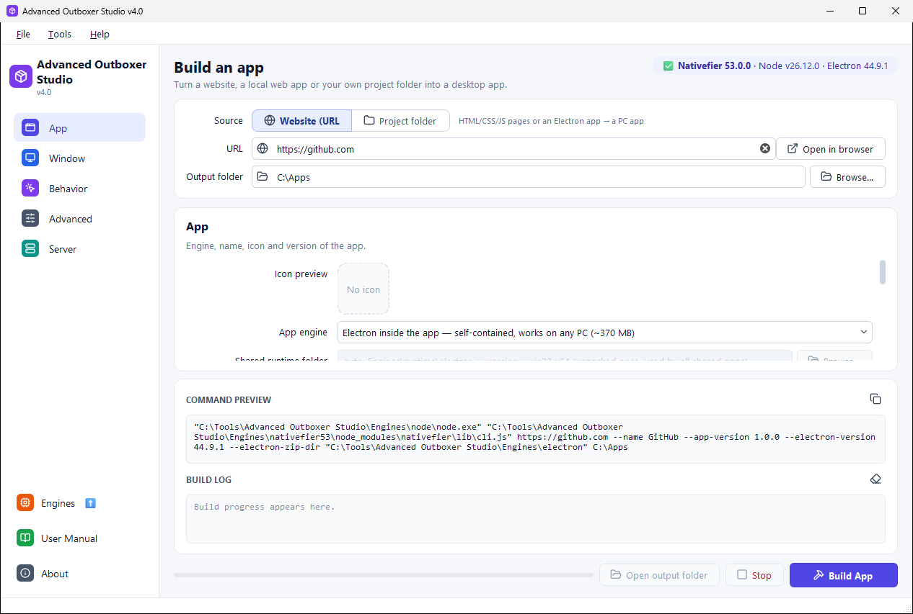
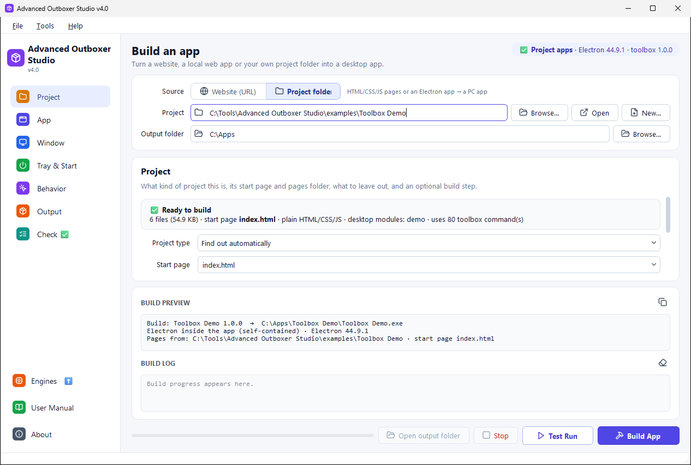
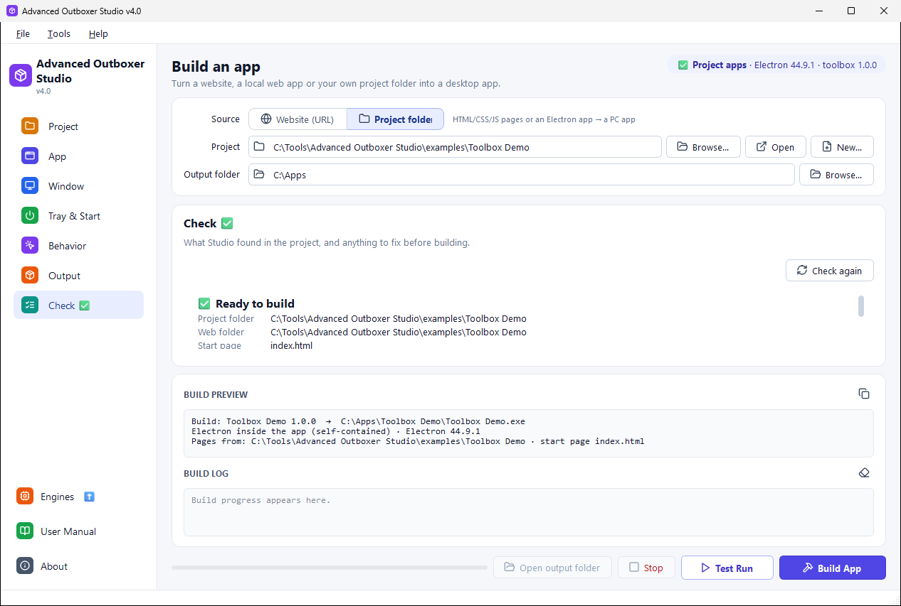
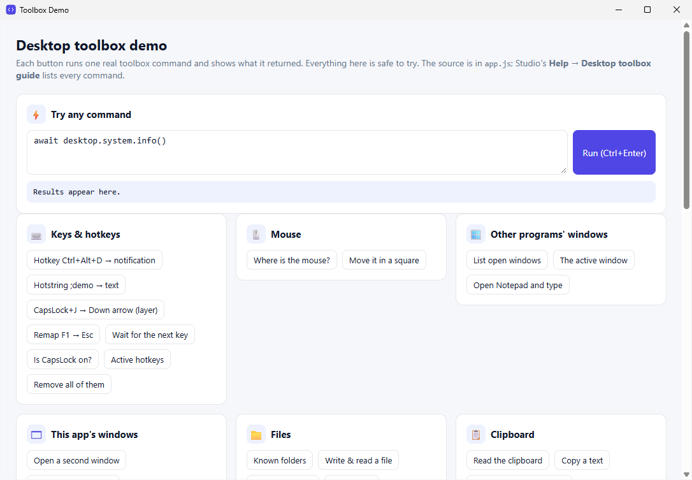
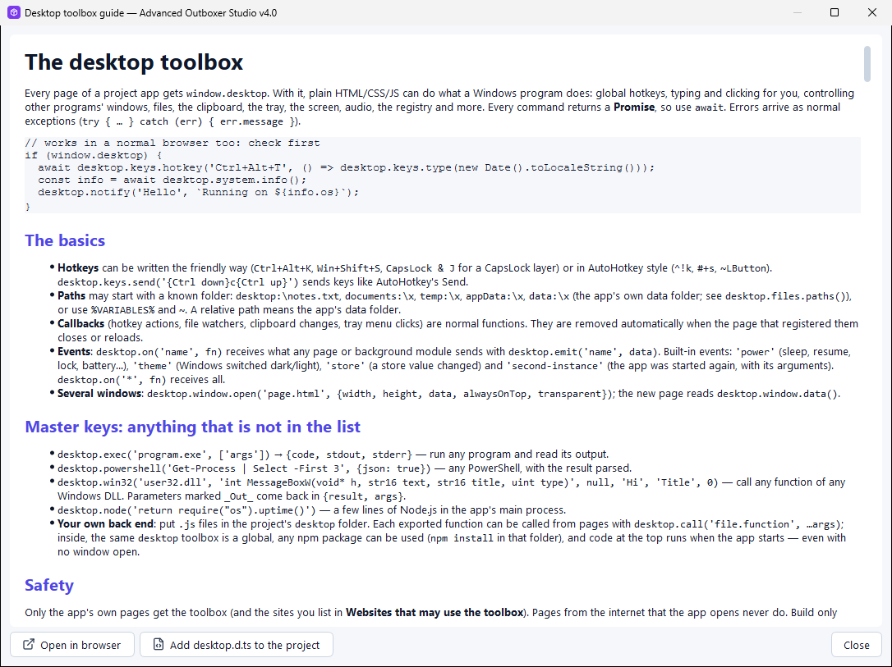
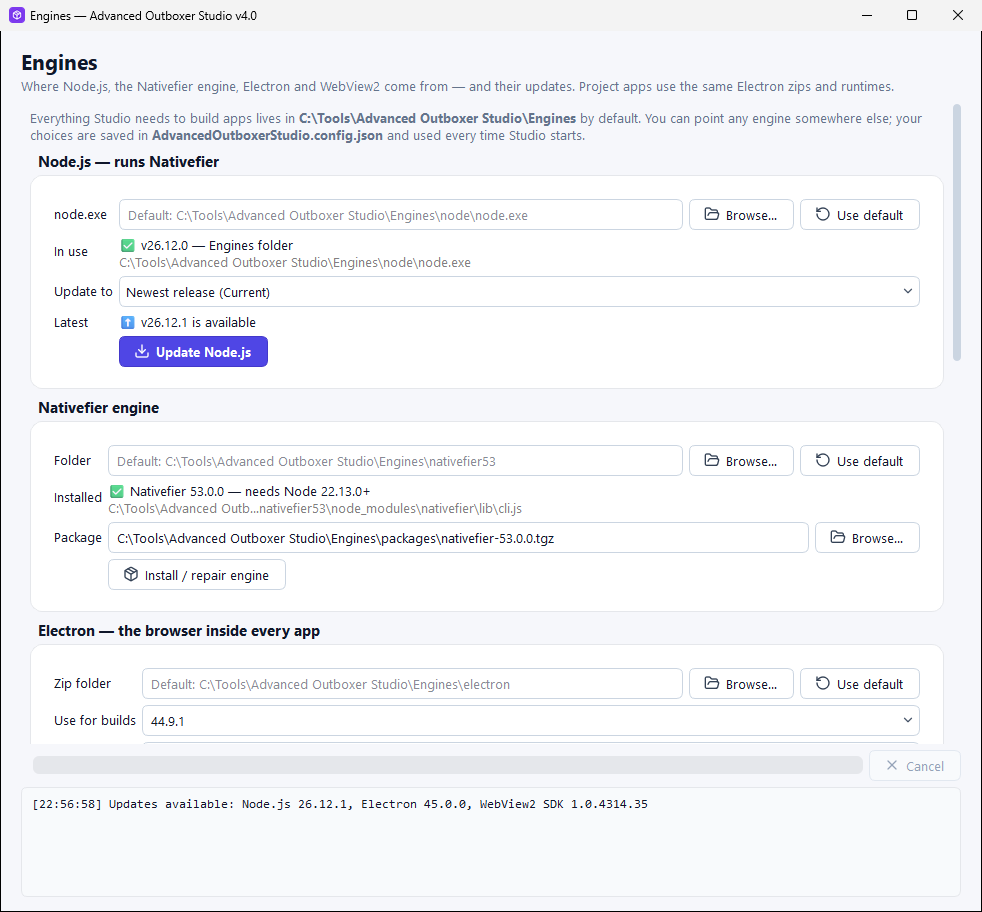

# Advanced Outboxer Studio — Full guide

Advanced Outboxer Studio turns **a website**, **a web app with its own local server**, or **a whole HTML/CSS/JS project folder** into a Windows desktop application with its own window, icon, taskbar entry and shortcut. You fill in a form, press **Build App**, and the finished app appears in your output folder.

**Contents**

1. [Install and start](#1-install-and-start)
2. [Quick start: a website as an app](#2-quick-start-a-website-as-an-app)
3. [Choosing an app engine](#3-choosing-an-app-engine)
4. [The main window](#4-the-main-window)
5. [Website options, section by section](#5-website-options-section-by-section)
6. [Apps with their own local server](#6-apps-with-their-own-local-server)
7. [Presets](#7-presets)
8. [Project folders](#8-project-folders)
9. [Electron app folders](#9-electron-app-folders)
10. [Projects that need building (React, Vue, Vite…)](#10-projects-that-need-building-react-vue-vite)
11. [The desktop toolbox (`window.desktop`)](#11-the-desktop-toolbox-windowdesktop)
12. [The Engines window](#12-the-engines-window)
13. [Where things are](#13-where-things-are)
14. [Using the apps you build](#14-using-the-apps-you-build)
15. [Sharing apps](#15-sharing-apps)
16. [Troubleshooting](#16-troubleshooting)
17. [Safety notes](#17-safety-notes)

---

## 1. Install and start

**Requirements:** 64-bit Windows 10 or 11. Nothing else: Python, Node.js, Nativefier, Electron and the WebView2 SDK are all in the download.

**From GitHub**

1. Download `Advanced-Outboxer-Studio-v4.0-win64.zip` from the [latest release](https://github.com/Alsharifs/Advanced-Outboxer-Studio/releases/latest).
2. Extract it to a folder with a **short path**, for example `C:\Tools\Advanced Outboxer Studio`. Don't run it from inside the zip.
3. Double-click **`Advanced_Outboxer_Studio.bat`**. It uses the Python in `Engines\python`.

> Keep the path short. If the folder path is longer than about 100 characters, Windows' 260-character path limit stops Qt from loading, and Studio fails with *"no Qt platform plugin could be initialized"*.

**From npm** (if you have Node.js 18+)

```bash
npx @alsharif/outboxer-studio
```

This downloads the same release once (about 405 MB), checks its SHA256 checksum, installs it to `%LOCALAPPDATA%\OutboxerStudio-npm\app` and starts it. Later runs start straight away. To update, close Studio and run `npx @alsharif/outboxer-studio@latest`. Your `AdvancedOutboxerStudio.config.json` is kept.

---

## 2. Quick start: a website as an app



1. Keep **Source** on **Website (URL)** and type or paste the address in **URL**. You can also drag a link onto the window.
2. Optional: on the **App** section, give the app a name and an icon. If you leave them empty, Studio reads the name and icon from the website.
3. Choose the **App engine** at the top of the App section (see [section 3](#3-choosing-an-app-engine)). If unsure, keep the first one.
4. Click **Build App**. Progress appears in the **Build log**.
5. When the log says **Done!**, the app is in a folder with the app's name in your **Output folder** (empty = your Desktop). Click **Open output folder** and double-click the app.

Building the same app again replaces the older build. Its saved data and logins are kept.

---

## 3. Choosing an app engine

| App engine | App size | Best for |
| --- | --- | --- |
| **Electron inside the app** | about 370 MB | Apps you give to other people. Works the same on every Windows PC; nothing else needed. |
| **Electron shared runtime** | about 2 MB | Many apps on your own PC. All of them use one shared copy of Electron (set in *Shared runtime folder*). |
| **WebView2** | about 1 MB | Small, fast apps for Windows 10/11, using the Microsoft Edge engine that is part of Windows and kept up to date by it. |

Options that the chosen engine does not use are greyed out automatically.

- **Electron** carries its own browser (Chromium), so apps look and behave the same everywhere.
- **Shared runtime** apps contain a small launcher, an app folder and a file `electron-runtime.txt`, whose first line is the Electron folder the app runs on. Edit that line in Notepad to point the app to another Electron without rebuilding. Keep the runtime folder as long as any app uses it.
- **WebView2** apps are built by Studio itself; no Nativefier, Node.js or Electron is involved. Their settings are in `app.json` next to the `.exe`, and you can edit it (for example the address) without rebuilding. If a PC doesn't have the WebView2 Runtime, the app offers to open Microsoft's download page.

---

## 4. The main window

- **Engine line** (top right): what will build the app, for example the Nativefier, Node.js and Electron versions, or the WebView2 runtime and SDK. A red ❌ tells you what is missing.
- **Engines** (bottom left): opens the [Engines window](#12-the-engines-window). It shows ⬆ when updates are available.
- **URL**: the website or local address (`http://` or `https://`). **Open in browser** checks it first.
- **Output folder**: where the app folder is created. Empty = your Desktop.
- **Sections** (left): App, Window, Behavior, Advanced, Server (see [section 5](#5-website-options-section-by-section)).
- **Command preview**: the exact Nativefier command (Electron engines) or the `app.json` settings (WebView2) that will be used. The copy button copies it.
- **Build log**: everything that happens during the build. The eraser clears it.
- **Build App** starts, **Stop** cancels, **Open output folder** opens the finished app's folder.

---

## 5. Website options, section by section

Empty or *(default)* means: use the normal behaviour. Hover over any field to see the exact Nativefier option it sets.

### App

- **App engine** and **Shared runtime folder**: see [section 3](#3-choosing-an-app-engine). An empty runtime folder means automatic (`Engines\runtime\electron-v<version>-win32-x64`).
- **App name**: window title, folder and `.exe` name. Empty = taken from the website.
- **Platform / Architecture**: Windows/x64 by default (your PC). WebView2 apps are Windows only.
- **Icon**: `.ico` or `.png` (`.icns` for Mac). Empty = the website's icon (not possible for local-server apps, because their site isn't running during the build).
- **App version** (default 1.0.0), **Build version**, **Copyright**: shown in the `.exe`'s properties.
- **Electron version**: overrides the default set in the Engines window, for this app only.
- **Portable**: keeps the app's data (logins, cache) inside the app folder. Careful: whoever gets a copy of the folder also gets those logins. Portable apps are never replaced by a rebuild; a new folder "(2)" is made.
- **Single instance**: opening the app again brings the existing window to the front.
- **Pack app source into asar** (Electron): hides the app's code in one archive file.

### Window

- **Width/Height**, **Min/Max width/height**, **X/Y position**: 0 = default. Apps remember the size and position you leave them at.
- **Start full screen**, **Start maximized**, **Hide window frame**, **Always on top**.
- **Show menu bar**: otherwise the menu is hidden and appears when you press Alt.
- **System tray**: *true* means closing the window keeps the app running in the tray; *start-in-tray* means the app starts hidden in the tray.
- **Title bar style** (Mac only), **Background color** (for example `#1e1f24`, shown while pages load).

### Behavior

- **Internal URLs**: a regular expression of addresses that should open inside the app. By default the site's own domain and common sign-in pages (Google, Microsoft, Apple…) stay inside; other sites open in your normal browser.
- **Strict internal URLs**: only the exact same host stays inside. **Block external URLs**: other sites don't open at all.
- **User agent**: how the app introduces itself to websites: `chrome`, `edge`, `firefox`, `safari`, or your own text. Use it when a site says your browser is not supported.
- **Zoom factor**: for example `1.25` for 125 %.
- **Show unread counter**: a number like "(3)" in the page title becomes a badge on the taskbar icon.
- **Bounce dock**, **Quit when window closes**: Mac only.
- **Disable context menu** (right-click menu), **Disable DevTools** (F12 / Ctrl+Shift+I).
- **Clear cache on start**: the app forgets its data on every start, so you are signed out each time.
- **Inject CSS / JS files**: your own style sheets or scripts added to every page, for example `#banner { display: none !important; }` to hide an element.

### Advanced

- **Proxy rules**: for example `http://proxy:8080`.
- **Basic auth user / password**: for sites protected by a browser sign-in box. They are given only to the app's own site.
- **Disk cache size** (bytes), **Language** (for example `en-US`, `ar`).
- **File download options**: JSON, for example `{"saveAs": true}` to ask where to save every download.
- **BrowserWindow options** (Electron): advanced Electron window settings in JSON.
- **Global shortcuts**: a JSON file of keyboard shortcuts that work even when the app is in the background, for example a media key that presses Space in the app.
- **Ignore certificate errors**, **Allow insecure content**: only for trusted internal sites; they reduce security.
- **Disable GPU**, **Ignore GPU blacklist**, **Enable WebGL 2**: for display problems.
- **Honest user agent**, **Widevine DRM**, **Verbose**, **Quiet**, **Extra raw arguments**: Electron only.

---

## 6. Apps with their own local server

Some web apps need a small server running on your PC, for example `server.js` on `http://localhost:8080`. The **Server** section puts that server inside the app folder and starts it automatically, so users only need one folder.

- **Folder to bundle**: the folder that contains the server script and the site files. It is copied into `<App>\server`.
- **Server script**: default `server.js`.
- **Run the server with**:
  - **The app's own Node**: Electron apps run the server with their own built-in Node (nothing to install); WebView2 apps get a copy of Studio's `node.exe` inside the app.
  - **Node.js installed on the PC**.
  - **This node.exe**: any `node.exe` you choose.
- **Stop the server when the app closes**: recommended. The app then also becomes single-instance.
- **Create a desktop shortcut**, **Don't copy** (files and folders to leave out, separated by `;`).

How it starts: Electron apps get a launcher `Start <App>.vbs`, and the desktop shortcut points to it. WebView2 apps start and stop their server themselves, so just open the `.exe`. If a server is already running on that address, the app uses it. The server's messages are written to `server\server.log`.

Your data is kept: files the server saved inside the app's `server` folder are carried over when you rebuild.

---

## 7. Presets

Studio always starts with fresh, default settings. To keep the settings of an app, use **File → Save preset…** (Ctrl+S); later **File → Load preset…** (Ctrl+O) fills everything in again. **File → Reset all fields** goes back to the defaults.

---

## 8. Project folders

Your own pages become a Windows app on Electron, and every page can control the PC through the [desktop toolbox](#11-the-desktop-toolbox-windowdesktop).



1. Set **Source** to **Project folder**, then choose (or drag onto the window) the folder that has your `index.html`. No folder yet? **File → New project from template…** (Ctrl+N), or try **Help → Open the toolbox example project**.
2. Studio checks the project at once: start page, name, version, icon, broken links, wrong letter case in file names (Windows ignores case, a web server doesn't), and every `desktop.*` command the pages use. The **Check** section shows the details. Anything marked ❌ must be fixed before building.

   

3. Press **▶ Test Run**: the project runs as an app straight from its folder. Save a file and the app reloads by itself. F12 opens the developer tools, F5 reloads.
4. Press **Build App**. The finished app is in `<Output folder>\<App name>`.

The sections for projects are **Project**, **App**, **Window**, **Tray & Start**, **Behavior**, **Output** and **Check**. Each project keeps its settings in `outboxer.json` inside the project folder; it is saved on every Build and Test Run.

**Electron inside the app, or from this PC**

- **Inside the app**: the app folder contains Electron (about 250 MB) and runs on any Windows 10/11 PC.
- **From this PC (shared runtime)**: the app is only your pages plus a small launcher. It runs on the Electron folder named in `electron-runtime.txt` (by default `Engines\runtime\electron-v<version>-win32-x64`), and many apps can share one runtime.

This is the example project from **Help → Open the toolbox example project**, running with ▶ Test Run:



---

## 9. Electron app folders

A folder that is already a complete Electron app is recognised automatically. That means its `package.json` has a `"main"` naming its own main script, and it uses Electron. **Project type** on the Project section can force this. Studio then packages the app as it is: its own main script runs instead of Studio's host, so its own windows, tray, hotkeys and preload bridge work. Pick the app's whole source folder, not only its HTML pages, because pages alone can't work without their back end.

- **No npm needed.** Runtime packages come from the app's `node_modules`, or else from Studio (`koffi` is built in). Only packages found in neither are installed once with Studio's own Node/npm, which needs internet.
- **electron-builder settings** in `package.json` are used where they make sense: `productName`, `version`, `copyright`, `build.icon`, `extraResources` (put in the app's `resources` folder) and `extraFiles` (next to the exe). `node_modules`, tests and the `build` and `dist` folders are left out.
- When the app's Electron major version differs from Studio's, the app's own version is used.
- Through the small launcher exe (shared runtime, or Electron in the runtime folder), the app still sees itself as an installed app: `app.isPackaged` is true and `process.execPath` is the launcher, so "Start with Windows" and files next to the exe work.
- **▶ Test Run** runs the app straight from its folder with its own main script (like `npm start`). It doesn't reload by itself: press Stop and Test Run again after a change.
- The **Window**, **Tray & Start** and **Behavior** sections are greyed out, because the app controls those itself.

---

## 10. Projects that need building (React, Vue, Vite…)

For React, Vue, Svelte, Angular, Vite and similar projects, set the **Build command** (Studio fills in the one it detects, for example `npm run build`) and tick **Run the build command**. The web folder is then the build output (`dist`, `build`…). Node.js comes from the Engines window.

---

## 11. The desktop toolbox (`window.desktop`)

Every page of a project app gets `window.desktop`. With it, plain HTML/CSS/JS can do what a Windows program does: global hotkeys, typing and clicking for you, controlling other programs' windows, files, the clipboard, the tray, the screen, audio, the registry and more. Every command returns a **Promise**, so use `await`. Errors arrive as normal exceptions (`try { … } catch (err) { err.message }`).

```js
// works in a normal browser too: check first
if (window.desktop) {
  await desktop.keys.hotkey('Ctrl+Alt+T', () => desktop.keys.type(new Date().toLocaleString()));
  const info = await desktop.system.info();
  desktop.notify('Hello', `Running on ${info.os}`);
}
```



### The basics

- **Hotkeys** can be written the friendly way (`Ctrl+Alt+K`, `Win+Shift+S`, `CapsLock & J` for a CapsLock layer) or in AutoHotkey style (`^!k`, `#+s`, `~LButton`). `desktop.keys.send('{Ctrl down}c{Ctrl up}')` sends keys like AutoHotkey's Send.
- **Paths** may start with a known folder: `desktop:\notes.txt`, `documents:\x`, `temp:\x`, `appData:\x`, `data:\x` (the app's own data folder; see `desktop.files.paths()`), or use `%VARIABLES%` and `~`. A relative path means the app's data folder.
- **Callbacks** (hotkey actions, file watchers, clipboard changes, tray menu clicks) are normal functions. They are removed automatically when the page that registered them closes or reloads.
- **Events**: `desktop.on('name', fn)` receives what any page or background module sends with `desktop.emit('name', data)`. Built-in events: `'power'` (sleep, resume, lock, battery…), `'theme'` (Windows switched dark/light), `'store'` (a store value changed) and `'second-instance'` (the app was started again, with its arguments). `desktop.on('*', fn)` receives all of them.
- **Several windows**: `desktop.window.open('page.html', {width, height, data, alwaysOnTop, transparent})`; the new page reads `desktop.window.data()`.

### Master keys: anything that isn't in the list

- `desktop.exec('program.exe', ['args'])` → `{code, stdout, stderr}`: run any program and read its output.
- `desktop.powershell('Get-Process | Select -First 3', {json: true})`: any PowerShell, with the result parsed.
- `desktop.win32('user32.dll', 'int MessageBoxW(void* h, str16 text, str16 title, uint type)', null, 'Hi', 'Title', 0)`: call any function of any Windows DLL. Parameters marked `_Out_` come back in `{result, args}`.
- `desktop.node('return require("os").uptime()')`: a few lines of Node.js in the app's main process.
- **Your own back end**: put `.js` files in the project's `desktop` folder. Each exported function can be called from pages with `desktop.call('file.function', …args)`. Inside those files the same `desktop` toolbox is a global, any npm package can be used (`npm install` in that folder), and code at the top runs when the app starts, even with no window open.

### Every command

The **[command reference](TOOLBOX-API.md)** lists all 294 commands, generated from the toolbox source. In Studio, **Help → Desktop toolbox guide** shows the same list. Its **Add desktop.d.ts to the project** button makes VS Code suggest and explain every command as you type.

### Toolbox safety

Only the app's own pages get the toolbox, plus the sites you list in **Websites that may use the toolbox**. Pages from the internet that the app opens never do. Build only projects you trust, because their pages can control the PC.

---

## 12. The Engines window



Open it with **Engines**. Everything Studio uses lives in the `Engines` folder next to Studio by default. Any path can be changed, and your choices are saved in `AdvancedOutboxerStudio.config.json`.

- **Node.js** runs Nativefier for Electron builds. **Update Node.js** downloads the newest release (or the long-term-support one) from nodejs.org, verifies it and switches to it.
- **Nativefier engine**: the modernised Nativefier 53. **Install / repair engine** reinstalls it from the package in `Engines\packages`; it needs internet for its libraries.
- **Electron**: the zip files Electron apps are made from, and the version used for new builds. **Download latest Electron** gets and verifies the newest one. Double-click a version in the list to use it.
- **Shared Electron runtimes**: the unpacked Electron folders used by shared-runtime apps.
- **WebView2**: the Edge WebView2 Runtime on this PC (part of Windows) and the WebView2 SDK (two small Microsoft files put into each WebView2 app). Downloads are checked for Microsoft's signature.
- **Updates**: when it starts, Studio checks for new versions at most every 12 hours. You can turn that off (`auto_check_updates` in the settings file) or use **Check for updates now**. The activity log at the bottom shows what happened.

**Included in v4.0:** Python 3.14.8 (with PySide6 and Pillow), Node.js 26.12.0, Nativefier 53.0.0, Electron 44.9.1 (zip), shared Electron runtime 44.7.2 and WebView2 SDK 1.0.4258.31.

---

## 13. Where things are

| What | Where |
| --- | --- |
| Finished apps | `Desktop\<App name>` (or your Output folder) |
| Studio's engines | `<Studio folder>\Engines\`: node, nativefier53, electron, runtime, webview2, packages, python |
| Studio settings | `<Studio folder>\AdvancedOutboxerStudio.config.json` |
| Settings of a project | `<project folder>\outboxer.json` (saved on every Build / Test Run) |
| Data of project apps | `%APPDATA%\<App ID>`: store, db, logs (or the app's data folder when portable) |
| Data of Electron apps | `%APPDATA%\<App name>` (logins, cache) |
| Data of WebView2 apps | `%LOCALAPPDATA%\OutboxerStudio\Apps\<App name>` |
| Data of portable apps | inside the app folder |
| Server log | `<App>\server\server.log` |

---

## 14. Using the apps you build

Press **Alt** to show the menu if it is hidden. Useful shortcuts in WebView2 apps:

| Keys | Action | Keys | Action |
| --- | --- | --- | --- |
| Ctrl+R / F5 | Reload | Alt+Left / Alt+Right | Back / Forward |
| Alt+Home | Go to the app's home page | F11 | Full screen |
| Ctrl + / Ctrl − / Ctrl+0 | Zoom in / out / reset | Ctrl+L | Copy current address |
| Ctrl+P | Print | Ctrl+Shift+I | Developer tools (unless disabled) |
| Ctrl+W | Close window | Ctrl+Q | Quit |

The menu also has **Open in Default Browser**, **Clear App Data…** (signs out and clears the cache) and **About**. Electron apps have a similar menu.

---

## 15. Sharing apps

- Share the **whole app folder** (for example as a zip), not just the `.exe`.
- **Electron inside the app** is the safest choice for other people's PCs.
- **WebView2** apps work on Windows 10/11 PCs that have the WebView2 Runtime (almost all do). A server app also needs its `node.exe`, so use *The app's own Node* to include a copy.
- **Shared runtime** apps need the runtime folder too; send it along and edit `electron-runtime.txt`.
- Never share a **portable** app after signing in with it, because the logins travel with the folder.
- Windows SmartScreen may warn about apps you build, because they aren't code-signed.

---

## 16. Troubleshooting

| Problem | What to do |
| --- | --- |
| *"no Qt platform plugin could be initialized"* when Studio starts | Studio's folder path is too long. Move the folder somewhere short, like `C:\Tools\Advanced Outboxer Studio`. |
| Studio doesn't open at all | Start `Advanced_Outboxer_Studio.bat` and check that `Engines\python\pythonw.exe` exists. Re-extract the zip if files are missing. |
| ❌ in the engine line | Open **Engines**: install Node.js or repair the engine as shown there. |
| "Nativefier finished, but no app folder was created" | Read the log above it (often a failed download), then try **Install / repair engine**. |
| A site says the browser is not supported | Set **User agent** to `chrome` or `edge`. |
| Links open in my browser instead of the app | Add their address to **Internal URLs**, for example `.*example\.com.*`. |
| A local-server app shows "The app's server did not start" | The message shows the last lines of `server\server.log`. Common causes: the `node.exe` path is wrong, a file is missing from the bundled folder (check *Don't copy*), or another program uses the same port. |
| A WebView2 app says the runtime is missing | Click **Yes** to open Microsoft's page and install the "Evergreen" runtime. |
| An app was rebuilt but looks old | Close the app completely, also from the tray, before rebuilding. |
| `npx @alsharif/outboxer-studio` says Studio is running | Close Studio first; the launcher can't update files that are in use. |

---

## 17. Safety notes

- Pages in website apps can't reach your PC's files or Studio's internals.
- Camera, microphone, location, notifications and clipboard reading are allowed only for the app's own site.
- Downloads of Node.js, Electron and WebView2 are verified (checksums or Microsoft signatures) before use.
- Only use *Ignore certificate errors* and *Allow insecure content* for sites you trust.
- **Project apps are different**: their pages can control the PC, because that is what the toolbox is for. Build only projects you wrote or trust, and keep *Websites that may use the toolbox* empty unless the site is yours.
